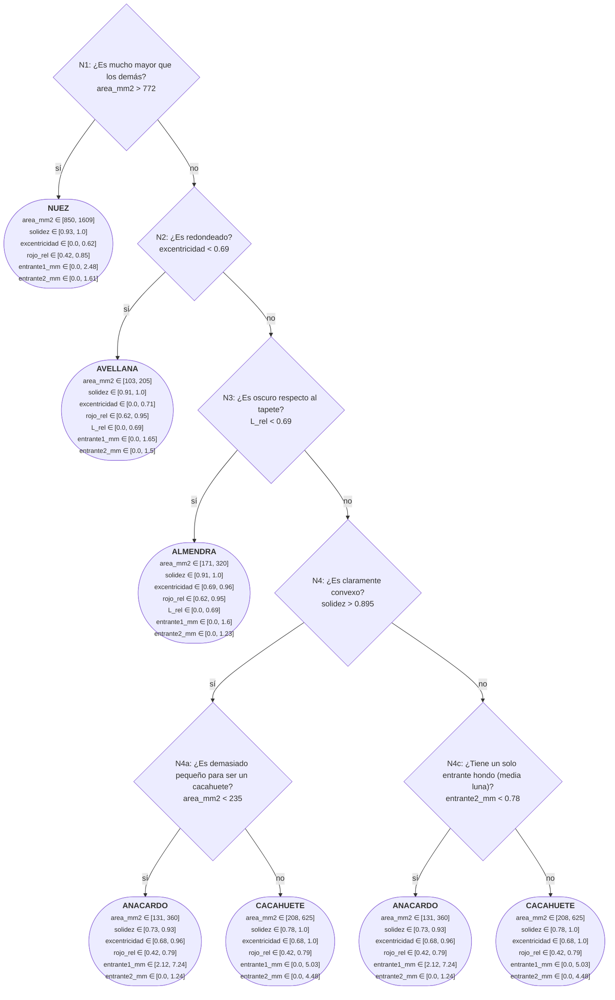

# Árbol de decisión

_Generado por `scripts/documentar.py` a partir de `config.yaml`._

## Nodos

| nodo | pregunta | regla (sí →) | justificación |
|---|---|---|---|
| N1 | ¿Es mucho mayor que los demás? | `area_mm2 > 772` | El área en mm² (escala calibrada) separa la nuez (Ø ~35 mm) de todas las demás clases con mucho margen (hueco de 456 mm²); no depende de la luz (la segmentación ExG no suma la sombra) ni de la distancia (se mide en mm). |
| N2 | ¿Es redondeado? | `excentricidad < 0.69` | La avellana es casi redonda. La excentricidad de la elipse de momentos usa todos los píxeles del objeto y es más estable que la relación de aspecto del rectángulo mínimo (sensible al ruido del borde). |
| N3 | ¿Es oscuro respecto al tapete? | `L_rel < 0.69` | Piel marrón oscura (almendra) frente a beige claro (anacardo, cacahuete), medida como luminancia RELATIVA al tapete que rodea al fruto: no depende de la intensidad de la luz. Separa con un hueco de 0,61 en desarrollo y de 1,1 en la sesión de la demo del 17/11 (almendras 0,43-0,52 vs. beige >= 1,6), donde la cámara cambió el color y rojo_rel de las almendras bajó a 0,72-0,75, dentro del beige. L_rel depende del ángulo de la luz (rasante), pero con el flash del móvil, siempre encendido y frontal, ese caso no se da. |
| N4 | ¿Es claramente convexo? | `solidez > 0.895` | El anacardo es curvo y deja mucho hueco en su envolvente convexa; la vaina del cacahuete suele ser casi convexa: por encima de 0,895 no hay ningún anacardo curvo y es cacahuete (salvo el anacardo de canto, N4a). Por debajo la solidez NO decide: los cacahuetes con mucha cintura o en gancho bajan a 0,83-0,88, dentro del rango del anacardo [0,778, 0,884]; decide N4c. |
| N4a | ¿Es demasiado pequeño para ser un cacahuete? | `area_mm2 < 235` | Un anacardo visto de canto apenas enseña su curva y sale convexo (solidez 0,91 en la demo con flash, por encima de N4), pero es mucho más pequeño que la vaina de cacahuete más pequeña medida (259 mm²). Su hoja sigue exigiendo el entrante de media luna (>= 2,12 mm). |
| N4c | ¿Tiene un solo entrante hondo (media luna)? | `entrante2_mm < 0.78` | El anacardo tiene UN entrante hondo (la media luna) y el segundo es casi nulo; el cacahuete cóncavo lo es por la cintura, que entra por AMBOS lados (o por un gancho), así que su segundo entrante es hondo. Un cacahuete de una semilla no tiene cintura, pero es muy convexo y ya lo decide N4. |

## Hojas y rangos de validación

Si un objeto llega a una hoja pero alguna característica cae fuera del rango medido de esa clase, se clasifica como **desconocido**.

| clase | validar |
|---|---|
| nuez | area_mm2 ∈ [850, 1609], solidez ∈ [0.93, 1.0], excentricidad ∈ [0.0, 0.62], rojo_rel ∈ [0.42, 0.85], entrante1_mm ∈ [0.0, 2.48], entrante2_mm ∈ [0.0, 1.61] |
| avellana | area_mm2 ∈ [103, 205], solidez ∈ [0.91, 1.0], excentricidad ∈ [0.0, 0.71], rojo_rel ∈ [0.62, 0.95], L_rel ∈ [0.0, 0.69], entrante1_mm ∈ [0.0, 1.65], entrante2_mm ∈ [0.0, 1.5] |
| almendra | area_mm2 ∈ [171, 320], solidez ∈ [0.91, 1.0], excentricidad ∈ [0.69, 0.96], rojo_rel ∈ [0.62, 0.95], L_rel ∈ [0.0, 0.69], entrante1_mm ∈ [0.0, 1.6], entrante2_mm ∈ [0.0, 1.23] |
| anacardo | area_mm2 ∈ [131, 360], solidez ∈ [0.73, 0.93], excentricidad ∈ [0.68, 0.96], rojo_rel ∈ [0.42, 0.79], entrante1_mm ∈ [2.12, 7.24], entrante2_mm ∈ [0.0, 1.24] |
| cacahuete | area_mm2 ∈ [208, 625], solidez ∈ [0.78, 1.0], excentricidad ∈ [0.68, 1.0], rojo_rel ∈ [0.42, 0.79], entrante1_mm ∈ [0.0, 5.03], entrante2_mm ∈ [0.0, 4.48] |
| anacardo | area_mm2 ∈ [131, 360], solidez ∈ [0.73, 0.93], excentricidad ∈ [0.68, 0.96], rojo_rel ∈ [0.42, 0.79], entrante1_mm ∈ [2.12, 7.24], entrante2_mm ∈ [0.0, 1.24] |
| cacahuete | area_mm2 ∈ [208, 625], solidez ∈ [0.78, 1.0], excentricidad ∈ [0.68, 1.0], rojo_rel ∈ [0.42, 0.79], entrante1_mm ∈ [0.0, 5.03], entrante2_mm ∈ [0.0, 4.48] |
