# Pipeline completo

```mermaid
flowchart LR
    A["Imagen RGB<br/>(foto o cámara cenital)"] --> B["Preprocesado<br/>reescalado a 1600 px<br/>+ Gauss 3×3"]
    B --> C["Segmentación<br/>ExG = 2g−r−b sobre<br/>cromaticidad lineal<br/>(umbral adaptativo)"]
    C --> D["ROI del tapete<br/>mayor región verde<br/>→ envolvente convexa"]
    D --> E["Objetos = NO verde ∩ ROI<br/>apertura + cierre (mm)<br/>+ relleno de huecos ≤ 3 mm²"]
    E --> F["Detección (Nivel 1)<br/>componentes conexas<br/>+ filtro de área (mm²)"]
    F --> G["Separación de contactos<br/>transf. distancia → máximos prominentes<br/>cuello + ΔE color → watershed"]
    G --> H["Características<br/>forma (mm, mm², momentos)<br/>+ color relativo al tapete"]
    H --> I["Árbol de decisión (Nivel 2)<br/>declarado en config.yaml<br/>+ validación de rango"]
    I -. "desconocido: hipótesis multiescala<br/>+ cortes por entrantes<br/>(verificación, menos área sin explicar)" .-> G
    I --> V["Ajuste de la partición<br/>unir mitades válidas<br/>+ fronteras por watershed de color"]
    V --> J["Identificación<br/>clase + traza de decisión"]
    J --> K["Interpretación (Nivel 3)<br/>conteo, distribución %,<br/>peso estimado, lote"]

    CAL["Calibración (tapete vacío)<br/>escala mm/px (+ rango HSV)"] -.-> C
    CAL -.-> F
```

| Etapa | Módulo | Salida |
|---|---|---|
| Calibración | `src/calibracion.py` | rango HSV del verde, mm/px, campo de visión |
| Preprocesado | `src/preprocesado.py` | imagen a resolución de trabajo |
| Segmentación | `src/segmentacion.py` | máscara verde, ROI, máscara de objetos |
| Detección | `src/deteccion.py` | regiones, separación por cuello/color, cortes por entrantes |
| Verificación | `src/pipeline.py` (`Verificador`) | partición más coherente con el árbol; une mitades de un fruto y ajusta las fronteras a la imagen |
| Características | `src/caracteristicas.py` | diccionario de características por objeto |
| Árbol | `src/arbol.py` + `config.yaml` | clase + traza |
| Interpretación | `src/interpretacion.py` | inventario, distribución, lote |
| Visualización | `src/visualizacion.py` | imagen anotada + panel de inventario |
